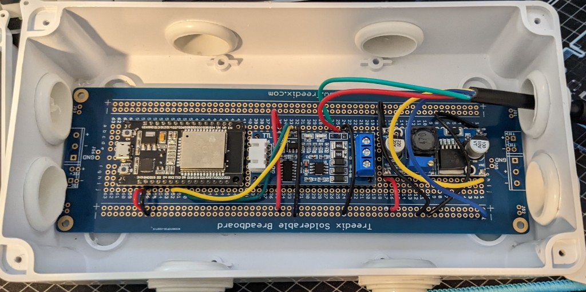

# Sundance Spa — ESPHome RS485 Component

Local control and monitoring for **"encrypted" Sundance and Jacuzzi spas** (Sundance 780 series and
compatible Jacuzzi models) over their RS485 bus — exposed to [Home Assistant](https://www.home-assistant.io/)
via native [ESPHome](https://esphome.io/) integration. It is a free replacement for the expensive
Jacuzzi/Sundance **cellular (ProLink) or Wi‑Fi (SmartTub) modules**, with no cloud dependency.

Unlike RS485→TCP→MQTT bridges, this component runs **on an ESP32 wired directly to the spa bus**.
Home Assistant talks to the device over the ESPHome API — no MQTT broker or serial gateway required.

---

## What it does

The spa's topside panel talks to the mainboard over a multi-drop **RS485** bus using a Balboa-derived,
lightly "encrypted" (XOR-encoded) protocol. This project:

1. **Connects** to the spa's RS485 bus through a TTL↔RS485 transceiver on an ESP32.
2. **Joins the bus** as a virtual panel — it performs the Balboa channel-assignment handshake so the
   mainboard treats it like another control panel.
3. **Decodes** the status traffic (current/set temperature, heater state, jets, circulation pump,
   lights/colors, rest mode, etc.).
4. **Exposes** that state as ESPHome entities (climate, switches, selects, sensors) that appear in
   Home Assistant automatically.
5. **Accepts commands** from Home Assistant and applies them by emulating panel button presses on
   the bus.

```
 ┌────────────┐     RS485    ┌────────────────────┐    Wi‑Fi    ┌────────────────┐
 │  Spa main  │◀──────────▶│  ESP32 + TTL↔RS485 │◀─────────▶│  Home Assistant│
 │  board     │      bus     │  (this component)  │   ESPHome   │  (native API)  │
 └────────────┘              └────────────────────┘             └────────────────┘
```

## Features

- **No cloud, no subscription** — fully local control.
- **Native ESPHome / Home Assistant** — entities appear when the device is adopted; no MQTT YAML.
- **Temperature** monitoring and set-point control (climate entity, °F).
- **Jets** — Jet 1 and Jet 2 as switches.
- **Circulation** — single-press button (matches the topside ClearRay/circ button) plus a status
  text sensor (`Off` / `Running (Auto)` / `Running (Manual)`).
- **Lights** — brightness cycle (`Off` / `Low` / `Medium` / `High`) and color/effect select.
- **Heater / rest-mode / communication** sensors.
- Runs from spa accessory power via a buck converter (no separate wall wart in the cabinet).

## Home Assistant entities

From the included [`example.yaml`](example.yaml):

| Entity | Type | Notes |
| --- | --- | --- |
| Spa | `climate` | Current temp, set temp, heat action; °F |
| Jet 1 / Jet 2 | `switch` | Jet pumps |
| Circulation | `button` | One ClearRay/circ press (not a latching switch) |
| Circulation Pump | `text_sensor` | `Off` / `Running (Auto)` / `Running (Manual)` |
| Lights | `select` | `Off`, `Low`, `Medium`, `High` |
| Light Color | `select` | Color / blend modes (see below) |
| Light Status | `text_sensor` | `Off` / `On` / `Seeking` |
| Heater | `binary_sensor` | Heater active |
| Rest Mode | `binary_sensor` | Spa in rest mode |
| Spa Communication | `binary_sensor` | Bus link healthy |

**Light colors:** White, Blue, Green, Red, Violet, Amber, Aqua, Slow Blend, Fast Blend, Frozen Blend.

### Quirks worth knowing

- **Circulation is a button, not a switch.** During filter/heat cycles the spa already runs circ in
  auto, and a "manual" mode often will not latch the way a simple on/off switch would. Pressing the
  button mirrors the topside; watch the **Circulation Pump** text sensor for actual state.
- **Lights are cycle-only on the bus.** The selects seek by issuing button presses until the
  reported state matches the target. While that is in progress, **Light Status** shows `Seeking`.
- **Climate is heat-only** — there is no cool mode on these spas.

---

## Getting started

1. Confirm your spa uses a Balboa-derived Sundance/Jacuzzi RS485 panel bus (developed against a
   Sundance 780 series; other models with the same encrypted bus may work).
2. Gather the parts below.
3. Flash the ESP32 with ESPHome using [`example.yaml`](example.yaml) (or your own config).
4. Wire the hardware and install it in a waterproof enclosure.
5. Plug into an unused Micro-Fit panel/accessory connector on the spa (or a Y-cable if the port is
   already occupied).
6. Adopt the device in Home Assistant and get tubbin'.

---

## Parts

| Part | Notes |
| --- | --- |
| **ESP32 DevKit** | ESP32-WROOM DevKitC-style board (USB for first flash). Example config uses `esp32dev` with `minimum_chip_revision: "3.1"`. |
| **TTL → RS485 module** | Hardware auto flow-control preferred (e.g. “TTL to RS485” modules with VCC/TXD/RXD/GND + A/B screw terminals). If your module needs DE/RE, wire a GPIO and set `flow_control_pin` in YAML. |
| **DC-DC buck converter** | LM2596-style step-down. Spa bus accessory power is typically ~12–14 V; set the **output to 5 V** for ESP32 VIN / 5 V rail. |
| **Solderable breadboard** | e.g. Treedix or similar proto board that fits a waterproof junction box. |
| **Waterproof junction box** | Outdoor/wet-location box with cable gland/grommet for the spa cable. |
| **Spa interconnect cable** | [NFHK ATX Molex Micro Fit 4-Pin Male–Male, 20 AWG, ~60 cm, 3.0 mm pitch](https://www.amazon.com/dp/B0CQC6PY1C) — plugs into an unused spa connector. |
| **Hookup wire / jumpers** | For TTL UART and breadboard power rails. |

Hardware layout is essentially the same as [jrowny/ESPHomeSpa](https://github.com/jrowny/ESPHomeSpa)
and [cribskip/esp8266_spa](https://github.com/cribskip/esp8266_spa), but built around an **ESP32**
(5 V on VIN) instead of a 3.3 V Wemos.



---

## Hardware connections

Identify the four conductors on the spa side (power pair + RS485 A/B) before trusting wire colors.
Colors vary by cable; use a multimeter. See also
[ccutrer/balboa_worldwide_app — physical layer](https://github.com/ccutrer/balboa_worldwide_app/wiki#physical-layer).

### Finding the wires

1. With the cable plugged into the spa (other end unconnected and insulated), measure pairs with a
   multimeter.
2. One opposite pair should read roughly **12–14 V** — that is **VIN+** and **GND**.
3. Keep the black probe on GND and measure the other two wires — both should sit around **2–3 V**.
   The slightly higher is typically **RS485+ (A)**; the lower is **RS485− (B)**.
4. Swapping A and B will not damage the bus; you will just get garbage (or a topside **NO COMM**).
   Swap them if that happens.

### Power

| From | To |
| --- | --- |
| Spa VIN+ (~12–14 V) | Buck converter **IN+** |
| Spa GND | Buck converter **IN−** |
| Buck **OUT+** (set to **5 V**) | Breadboard `+` rail → ESP32 **VIN** (or 5 V) and RS485 module **VCC** |
| Buck **OUT−** | Breadboard `−` rail → ESP32 **GND** and RS485 module **GND** |

> **Important:** Set the buck output to **5 V** for a typical ESP32 DevKit on VIN.
> (The classic Wemos/ESP8266 guides use 3.3 V — do **not** copy that voltage for DevKit VIN.)

### RS485 data

| From | To |
| --- | --- |
| Spa RS485 A (+) | RS485 module **A** |
| Spa RS485 B (−) | RS485 module **B** |
| ESP32 **GPIO23** (TX) | RS485 module **TXD** / DI |
| ESP32 **GPIO22** (RX) | RS485 module **RXD** / RO |
| ESP32 GND | RS485 module GND (shared with power rail) |

Pins above match [`example.yaml`](example.yaml). Change the UART `tx_pin` / `rx_pin` if you wire
differently (some builds use GPIO17/16).

Optional: if your transceiver needs direction control, connect DE/RE to a free GPIO and uncomment
`flow_control_pin` under `sundance_spa:` in the YAML.

### Spa connector

Plug the Micro-Fit male–male cable into an **unused** 4-pin accessory/panel connector on the spa
control box. If the only port is already occupied (Wi‑Fi module, second panel, etc.), use a Balboa
Y-splitter so both devices stay on the bus.

---

## Software setup

1. Install [ESPHome](https://esphome.io/guides/getting_started_command_line.html) (or use the HA
   add-on).
2. Copy [`example.yaml`](example.yaml) into your ESPHome config directory.
3. Create `secrets.yaml` with:

   ```yaml
   wifi_ssid: "..."
   wifi_password: "..."
   wifi_fallback_password: "..."
   api_encryption_key: "..."   # esphome -q new-key
   ota_password: "..."
   ```

4. Point `external_components` at this repository (or use a local `path:` during development):

   ```yaml
   external_components:
     - source: github://YOUR_GITHUB_USER/YOUR_REPO@main
       components: [sundance_spa]
   ```

5. Flash over USB the first time, then OTA afterward:

   ```bash
   esphome run your-config.yaml
   ```

6. In Home Assistant → **Settings → Devices & services → ESPHome**, adopt the device.

### UART / component options

| Option | Default | Notes |
| --- | --- | --- |
| UART baud | `115200` 8N1 | Required by the bus |
| `tx_pin` / `rx_pin` | `GPIO23` / `GPIO22` | Match your wiring |
| `temperature_scale` | `F` | Fahrenheit |
| `rx_invert` | `false` | Try `true` only if RX levels are inverted on your transceiver |
| `flow_control_pin` | unset | Only for modules without auto direction |

---

## Debug

- **Voltages first** — confirm ~12–14 V into the buck and a stable **5 V** on the ESP32/RS485 rail.
- **RS485 LEDs** — on many TTL↔RS485 boards, RX (and sometimes TX) LEDs blink when the bus is alive.
  That means RS485→TTL conversion is working even before Wi‑Fi is up.
- **Spa Communication** sensor — should go on once the component completes channel negotiation and
  receives status frames. If it stays off, check UART pins, baud, and A/B polarity.
- **Swap A and B** — wrong polarity often garbles the bus; the topside may show **NO COMM**.
  Power down, swap A/B, power up again.
- **ESPHome logs** — `logger:` at `DEBUG` temporarily if you need frame-level detail; return to
  `INFO` for normal use.
- **Wi‑Fi** — keep the ESP32 in range of 2.4 GHz; metal spa cabinets can be harsh RF environments.
  An external antenna DevKit helps if reception is marginal.

---

## How the protocol works (brief)

Status frames are framed by `0x7E`, checksummed with the Balboa CRC, and the payload is XOR-decoded.
The component negotiates a panel channel on the RS485 bus, then parses status updates and light
status messages. Commands are sent as panel-style button-press messages on the assigned channel.

For the broader Balboa bus background see
[ccutrer/balboa_worldwide_app protocol notes](https://github.com/ccutrer/balboa_worldwide_app/blob/master/doc/protocol.md).
Sundance/Jacuzzi “encrypted” variants build on the same framing with additional XOR and channel
handshake behavior documented by community bridges such as
[HyperActiveJ/sundance780-jacuzzi-balboa-rs485-tcp](https://github.com/HyperActiveJ/sundance780-jacuzzi-balboa-rs485-tcp).

---

## Credits

- Protocol lineage: [garbled1/pybalboa](https://github.com/garbled1/pybalboa),
  [ccutrer/balboa_worldwide_app](https://github.com/ccutrer/balboa_worldwide_app)
- Sundance/Jacuzzi RS485 decoding and MQTT bridge reference:
  [HyperActiveJ/sundance780-jacuzzi-balboa-rs485-tcp](https://github.com/HyperActiveJ/sundance780-jacuzzi-balboa-rs485-tcp)
- Hardware approach inspired by [cribskip/esp8266_spa](https://github.com/cribskip/esp8266_spa) and
  [jrowny/ESPHomeSpa](https://github.com/jrowny/ESPHomeSpa)

## Disclaimer

This is an unofficial, community project and is not affiliated with Balboa Water Group, Sundance, or
Jacuzzi. Modifying or wiring into your spa's control bus may void warranties and carries risk of
damage or injury. Use entirely at your own risk. Verify voltages and pinouts with a meter before
connecting power to the ESP32.
