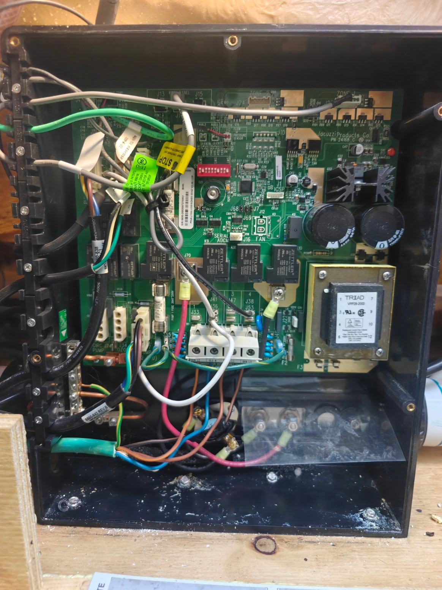
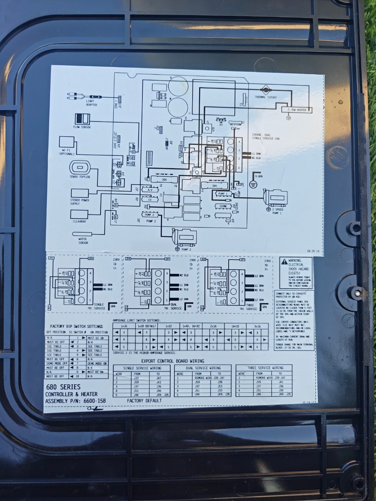
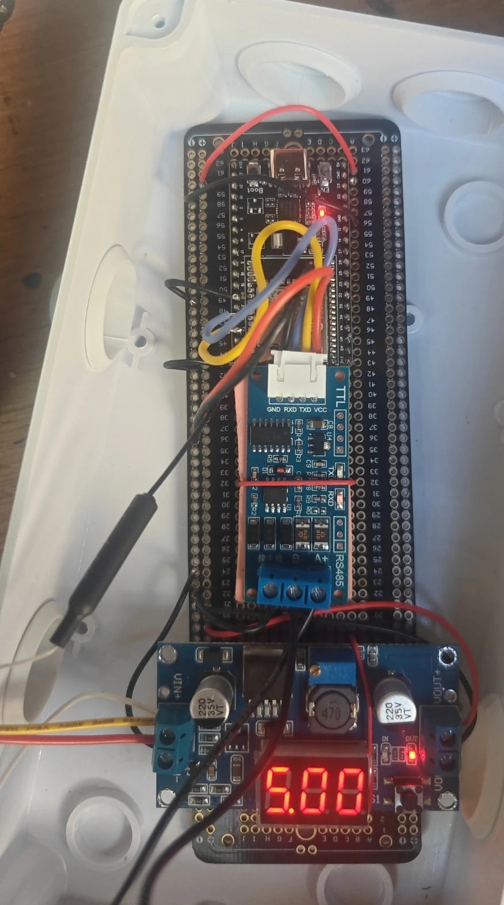
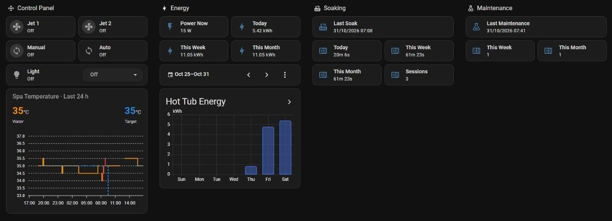

# Sundance 680 series — ESPHome RS-485 component

ESPHome component and decoding notes for **Sundance 680 series** spas (Balboa-based controller),
based on the Sundance 780 component by [Iraithium](https://github.com/Iraithium/sundance-rs485-controller)
— all credit for the original work goes to him. For the 780, see the original repository.
Example configuration: [example-680.yaml](example-680.yaml).

> **Tested on:** Sundance **680 series Peyton model year 2020** — *680 Series Controller & Heater,
> assembly P/N 6600-158*, main board marked *Jacuzzi Products Co. PN 24168_C* (export 50 Hz model, 3-phase hookup,
> 2-speed pump 1, pump 2, 2.7 kW heater, ClearRay UV, SD680 topside). The same board family
> is also used in **Jacuzzi J100 / J200** spas, so this work may apply to them as well (untested).
>
> **Connection:** the RS-485 module is connected to header **J15** on the controller board, at the
> top edge of the board next to J13 (MAIN PANEL, the SD680 topside).

| Controller board (J15 at the top) | Wiring diagram from the controller lid |
|---|---|
|  |  |

This document describes how the ESPHome `sundance_spa` component (originally written for the
**Sundance 780 series**) was adapted to a **Sundance 680 series Peyton** (2 pumps, Balboa
controller), what was decoded on the RS-485 bus, how sure we are about each part, and what is still
unknown. It is meant for anyone who wants to continue the work, reproduce it on another 680, or
spot mistakes.

> Status (2026-11-02): running daily on one spa. Temperature, set point, heater, both jets,
> circulation, lights, heater mode, clock/date (read + automatic sync to within a minute, incl. DST
> changes), service counters (with Off / Change Now), Primary Filter settings and states (incl.
> Cleanup and Purge), language, all four lock modes, temperature unit, run timers, activity
> sessions and a Decoder Notice are exposed to Home Assistant. Derived states are confirmed for 2 s
> before they are published, so the controller's flag hand-overs never show as blips. Electrical
> power was measured against the house load (§11); the power value of each load is a setting on
> the device. The Home Assistant side (helpers, automations, dashboard) is documented in
> [`homeassistant/`](homeassistant/README.md). A few status bits are still unknown — see
> [Open questions](#13-open-questions--help-wanted).

Contents

1. [Credits and upstream](#1-credits-and-upstream)
2. [Hardware and wiring](#2-hardware-and-wiring)
3. [What is different from the 780 code](#3-what-is-different-from-the-780-code)
4. [Home Assistant entities](#4-home-assistant-entities)
5. [Bus protocol basics](#5-bus-protocol-basics)
6. [Status frame (0xC4) field map](#6-status-frame-0xc4-field-map)
7. [Topside button codes (0xCC)](#7-topside-button-codes-0xcc)
8. [Lights frame (0xCA) and the 680 light cycle](#8-lights-frame-0xca-and-the-680-light-cycle)
9. [Topside menu: screens, masking and values](#9-topside-menu-screens-masking-and-values)
10. [Driving the menu from the ESP32](#10-driving-the-menu-from-the-esp32)
11. [Observed spa behaviour](#11-observed-spa-behaviour)
12. [Diagnostics entities](#12-diagnostics-entities)
13. [Open questions / help wanted](#13-open-questions--help-wanted)
14. [Known issues and limitations](#14-known-issues-and-limitations)
15. [How to test / reproduce](#15-how-to-test--reproduce)
16. [Development history](#16-development-history)

---

## 1. Credits and upstream

- Base component: [Iraithium/sundance-rs485-controller](https://github.com/Iraithium/sundance-rs485-controller)
  (ESPHome external component for the Sundance 780). The upstream repository has its files at the
  repository root (not under `components/`), so it cannot be used with `source: github://…`
  directly; here it is cloned into `config/esphome/components/sundance_spa` and used with
  `source: type: local`.
- Protocol background: HyperActiveJ `sundanceRS485` decoding notes (the 780 bit names in the code
  come from there).
- Upstream has **no LICENSE file** at the time of writing — keep that in mind before republishing
  derived code.
- Reference manual: Sundance *2020 680 Series Owner's Manual* (menu order, value ranges, heat modes,
  lock modes, error codes).

## 2. Hardware and wiring

| Item | Used here | Notes |
|---|---|---|
| Spa side | header **J15** on the 680 controller board (P/N 6600-158, board PN 24168_C) | see the photo at the top |
| MCU | **ESP32-WROOM-32UE** DevKit (chip rev 3.1) + a separate **external antenna** on its U.FL connector | upstream uses an ESP32-WROOM DevKitC with the PCB antenna. `minimum_chip_revision: "3.1"`, `esp32dev` 4 MB layout is plenty |
| RS-485 transceiver | TTL↔RS-485 module with **automatic direction control** | no DE/RE pin needed (`flow_control_pin` unused) |
| UART pins | **TX = GPIO1, RX = GPIO3** (UART0) | upstream uses GPIO23/22. UART0 means `logger: baud_rate: 0` (serial logging off, use API logs) |
| Spa cable | Molex Micro-Fit 3.0, 4-pin male–male (12 V, GND, A, B) | upstream lists a ~60 cm cable — see the recommendations below |
| Baud rate | 115200 8N1 | same as the 780 |
| Power | 5 V buck converter **fed from the spa** | the ESP32 power-cycles together with the spa (useful: it sees the spa's boot) |
| Framework | ESPHome 2026.10, Arduino | `sram1_as_iram: true` |

**Recommendations from this build:**

- **Use an external antenna.** The spa stands outdoors, so the Wi-Fi signal is weak — about −75 to
  −88 dBm here even with an external antenna. This build uses an ESP32-WROOM-32UE, which has a U.FL
  connector instead of a PCB antenna; the antenna is bought separately and connected by its lead.
- **Get a Micro-Fit cable longer than 60 cm** (1–1.5 m). 60 cm ties the box to the controller and
  limits where it — and its antenna — can be placed.



*This build: ESP32-WROOM-32UE DevKit with the external antenna lead (left), auto-direction
TTL↔RS-485 module (A+/B− screw terminals), and a buck converter showing its 5.00 V output, on a
proto board in an outdoor junction box.*

Minimal YAML (secrets and keys omitted; the full example is [example-680.yaml](example-680.yaml)):

```yaml
external_components:
  - source:
      type: local
      path: components

logger:
  baud_rate: 0        # UART0 is used by the RS-485 module
  level: DEBUG

uart:
  id: spa_uart
  tx_pin: GPIO1
  rx_pin: GPIO3
  baud_rate: 115200

time:
  - platform: homeassistant
    id: ha_time

sundance_spa:
  id: sundance_spa_id
  uart_id: spa_uart
  temperature_scale: C
  time_id: ha_time
  clock_auto_sync: true
  # ... sensors, see section 4
```

## 3. What is different from the 780 code

The 680 uses the **same framing, CRC and XOR-folded payloads** as the 780 (CRC init 0xB5 works,
zero CRC errors over millions of frames). The differences are in what the bits mean and in the
topside:

| Topic | 780 (upstream) | 680 (this work) |
|---|---|---|
| Pumps | Pump 1, Pump 2, separate circulation pump | **No separate circ pump.** Jet 1 is a **two-speed** pump: low speed = circulation/filtration, high speed = jets. Jet 2 single speed. |
| Jet 1 control | on/off | Two HA switches, mutually exclusive: **Jet 1** (high) and **Circulation** (manual low). Panel cycle is Off→Low→High→Off; during automatic filtration Jets 1 goes High→back to circulation. |
| Lights | brightness levels + colour select | **One Light button, 10 modes, no brightness.** Selecting a mode = pressing Light N times within ≤3 s; a press after ≥5 s turns the light off. |
| Heater mode | rest/ready | **Auto / Eco / Day** (f6 = 32/34/36) |
| Clock | time only | time **and date** decoded; HA→spa sync by navigating the menu |
| Service counters | not mapped | Water Refresh, Filter Change (status frame), ClearRay bulb (menu read); each as days / `Change Now` / `Off` |
| Settings | — | Primary Filter start/cycles/duration, language, lock, °C/°F (status or menu) |
| Screen codes | — | **XOR-masked by a key derived from the ClearRay counter** — it changes every midnight (see §9) |
| Climate modes | heat/off | **Heat only** — the 680 has no heater-off mode (ESPHome's traits start with OFF, so the set is replaced) |
| Temperature min | 80 °F-ish | 18 °C / 65 °F (680 manual) |

The bulk of the 680 logic is in a new file `sundance_680.cpp`; the existing files only get small
hooks (§16 lists the order in which things were added).

## 4. Home Assistant entities



*The owner's Hot Tub page in Home Assistant (top of the page). The tiles are this component's
entities; the energy, soaking/maintenance and run-time figures are Home Assistant helpers built on
them, and the chart and light card use the apexcharts and mushroom custom cards.*

**Updated live** (from the status/lights broadcast, several times per second):

Names are chosen so that related entities sort together (same first word).

| Entity | Values | Source |
|---|---|---|
| Sundance Spa (climate) | **Heat only**; target 18–40 °C step 0.5, current temp, action heating/idle | f5, f8, f10 bit6 |
| Heater | on/off | f10 bit6 |
| Jet 1 (switch) | on/off — high speed | f2 bit4 |
| Circulation (Manual) (switch) | on/off — manual low speed | f1 bit7 without the purge |
| Jet 2 (switch) | on/off | f1 bit2 |
| Light (select) | Off, High Speed Blend, Low Speed Blend, Frozen Blend, Blue, Violet, Red, Amber, Green, Aqua, Near White | lights frame |
| Light Status | same list | lights frame |
| Primary Filter | Purge / Running / Cleanup / Circulation (Manual) / Circulation (Auto) / Circulation (Heating) / Off | f1, f2, f10 bit7, see below |
| Primary Filter Active (binary) | scheduled filtration cycle | f10 bit7 |
| Pumps Running (binary) | any pump running | f1, f2 |
| Pump 1 Running / Pump 2 Running (binary) | Pump 1 = Jet 1 pump at either speed (incl. circulation), Pump 2 = Jet 2 | f1, f2 |
| Circulation (Auto) (binary) | circulation the controller runs itself (schedule, heat, purge) — only while a pump runs | f1, f10 bit7 |
| ClearRay Bulb | On / Off (inferred: Jet 1 pump running at any speed) | f1 bit6, f2 bit4 |
| Heater Mode | Auto / Eco / Day / Unknown (n) | f6 |
| Lock | Off / Access Lock / Temperature Lock / Settings Lock / Service Lock | AL f1 bit3, TL f10 bit4; SL/SVL tracked from panel events (§6) |
| Temperature Format | °C / °F | f14 bit6 |
| Clock Time | HH:MM (24 h) | f0, f11 |
| Clock Date | DD/MM/YYYY | f7, f9 + HA date |
| Remaining Days Water Refresh | days / `Change Now` / `Off` (text) | f12, f2 bit7 |
| Remaining Days Filter Change | days / `Change Now` / `Off` (text) | f3 (+ FC menu when 0, §6) |
| Jet 1 / Jet 2 / Light / Circulation / Heater Run Time | minutes since it turned on (0 when off) | computed in the ESP |
| *Item* Active (binary), In Use Session | Active = running now (In Use = Jet 2 or Jet 1 high); In Use Session = on once a use has lasted 10 min | computed; items: In Use, Jet 1, Jet 2, Heating Run, Primary Filter Active |
| Communication | on/off | frames received |
| Decoder Notice | `OK`, or the last thing the decoder could not handle (see below); back to `OK` after an hour | ESP |

**Primary Filter states** (in this order of precedence):
`Purge` — the 2-minute sequence after power-up or a Service Lock unlock (Jet 1 low, then Jet 2):
the controller keeps the manual-circulation bit (f1 bit 7) set for all of it although nobody pressed
Circulation; presses made meanwhile do not change the state. `Running` — Jet 1 high or Jet 2 started
by someone. `Cleanup` — Jet 2 started by the controller itself (no press in the previous 5 s; the
daily cleanup). `Circulation (Manual)` — Jet 1 low started by hand. `Circulation (Auto)` — scheduled
filtration. `Circulation (Heating)` — the pump runs for heat demand. Otherwise `Off`.

**2-second confirmation.** Primary Filter, ClearRay Bulb, Heater, Pumps Running, Pump 1 / Pump 2 Running, Circulation (Auto)
and every Active/Session sensor are published only after the new state has held for 2 s (run times
are counted from when the change began). The controller hands its flags over one or two status
frames apart — e.g. at the end of a filter cycle f1 reads 0x40 (looks like "Jet 1 low from the
panel") for about a second, and once f10 bit 7 dropped 0.3 s before the pump stopped ("Heating") —
which otherwise showed as 0.3–1.7 s blips. Switches, the light and Panel Button stay immediate.

**Decoder Notice** reports, at most about once an hour each: clock sync failed or left the clock a
minute or more off, settings read aborted, light or command not confirmed by the spa, ClearRay
shown on an unmapped screen, no status for 30 s, and a quiet topside screen that does not fit the
known ClearRay counter for 10 min — a steady one means the counter was set while the ESP did not
see it (the key is taken and the settings re-read), a changing one is a screen we don't know (§9).

**Updated only by reading the menu** (nightly at 00:05, ~2 min after every boot, on the *Read
Settings* button) **or when someone saves the value at the panel**:

| Entity | Values |
|---|---|
| Remaining Days ClearRay Bulb | days / `Change Now` / `Off` (text). Also captured when someone views or saves it at the panel, and counted down at midnight from the screen key without opening the menu (§9) |
| Primary Filter Start | HH:00 (24 h) |
| Primary Filter Cycles | 1–4 |
| Primary Filter Duration | hours |
| Language | English / French / Spanish / German |

**Event-driven**: *Clock Sync* (`Not synced yet` after boot / `Waiting for main screen` /
`OK HH:MM` / `OK (already within ±n s)` / `Failed: <reason>`).

**Temperature units**: the climate entity and the temperature sensor always use the unit set in
`temperature_scale` (here `C`). The panel can be switched to °F independently (f14 bit 6); the ESP
converts, so Home Assistant keeps receiving °C (rounded to 0.5 °C). Users who want °F in HA set
`temperature_scale: F`.

**Buttons**: Read Settings, Clock Sync Now, Restart, Safe Mode Boot.
**Config**: Diagnostics (verbose decoding logs on/off), Logger Level (runtime log level), and the
six **Power** values below.

**Power values** (`number`, *Configuration* on the device page, slider): the electrical power of
each load, for estimating the spa's consumption in Home Assistant (the spa does not report it).
They are plain template numbers in the YAML (`restore_value: true`), kept in the ESP's flash
across reboots and power cuts — the component itself does not use them. Defaults are this spa's
(§11); change them if you can measure your own.

| Entity | Default | Range |
|---|---|---|
| Power Controller | 15 W | 0–50 |
| Power ClearRay | 20 W (extra while Jet 1 runs at high; at low it is part of Circulation) | 0–60 |
| Power Light | 5 W | 0–50 |
| Power Circulation | 370 W (Pump 1 low + ClearRay) | 200–600 |
| Power Jet Pump | 1630 W (one pump at high) | 1000–2500, step 10 |
| Power Heater | 2700 W | 1500–4000, step 10 |

## 5. Bus protocol basics

Frame layout (unchanged from the 780):

```
7E  LEN  CH  BF  TYPE  payload…  CRC  7E
```

- `LEN` counts from LEN to CRC inclusive.
- `CRC` = CRC-8, polynomial 0x07, **init 0xB5**, final XOR 0x02, computed over `LEN … last payload byte`.
- Payloads of status (0xC4), lights (0xCA) and button (0xCC) frames are **XOR-folded**: each pair of
  bytes `(a, b)` decodes to one value `a ^ b ^ 0x01`. The field numbers below (f0…f15) refer to the
  decoded values.

Message types seen on a 680 (sensor *Bus Message Types*):

| Type | Meaning (from the 780 code / Balboa) | Seen |
|---|---|---|
| 0x00 | client clear-to-send | always |
| 0x01 | channel assignment request | at boot |
| 0x02 | channel assignment response | at boot |
| 0x03 | channel assignment ack | at boot |
| 0x04 | existing client request | at boot (first frame after power-up) |
| 0x06 | clear to send | always |
| 0xC4 | status update | always |
| 0xCA | lights update | always |
| 0xCC | topside button state (sent continuously, idle code when nothing pressed) | always |

0x00 and 0x06 frames carry **no payload** on the 680 (checked with the *Raw Other Messages*
diagnostic). Channels: 0x10 = this ESP32, 0x11 = topside panel, 0x12 = offered but unused, 0xFE =
broadcast.

The ESP32 requests its own channel (got 0x10 here) and sends button presses as 0xCC frames with the
button code in byte 5 and 0x00 in byte 6.

## 6. Status frame (0xC4) field map

Legend: ✅ confirmed against the panel (repeatable), 🟡 likely (few observations), ❓ unknown.

### Values

| Field | Meaning | Encoding | Confidence |
|---|---|---|---|
| f0 | hour (24 h) | `f0 ^ 6` | ✅ |
| f11 bits 0–6 | minute | plain | ✅ |
| f11 bit 7 | ? | never seen set | ❓ |
| f7 | day + month | `f7 = (((day ^ 1) << 3) + (month ^ 8)) & 0xFF` — ambiguous; the decoder tries `f7` and `f7 + 256` for all candidates and picks the one nearest the HA date | ✅ (all days of a year checked) |
| f9 | year | `(year - 2000) ^ 1` (power-up default decodes to 2014-01-01) | ✅ |
| f5 | water temperature | `f5 ^ 2`; °C mode: half degrees (69 → 34.5 °C); °F mode: whole °F | ✅ |
| f8 | set point | plain; °C: half degrees, °F: whole °F | ✅ |
| f6 | heater mode | 32 Auto, 34 Eco, 36 Day (16 for <1 s at power-up) | ✅ |
| f12 | Water Refresh days remaining | plain, decrements at midnight; 0 = Off **or** due (told apart by f2 bit 7) | ✅ |
| f3 | Filter Change days remaining | `f3 ^ 250`; raw 250 (= 0) both when the reminder is **Off** and when it is due (see below) | ✅ |
| f4 | ? | always 6 so far | ❓ |
| f13 | topside screen code | **XOR-masked**, see §9 | ✅ |
| f14 | slow value + flags | see [f14](#f14) below | ✅ |
| f15 | value shown in the current menu screen | plain, screen-specific encoding (§9) | ✅ |

### Bits

| Field.bit | Meaning | Confidence |
|---|---|---|
| f1.2 | Jet 2 running | ✅ |
| f1.3 | **Access Lock (AL)** active | ✅ |
| f1.5 | Jet 1 low speed commanded (set ~1 s before bit 6, cleared ~1 s before it) | 🟡 |
| f1.6 | Jet 1 low speed running (any reason: filtration, heating, manual, purge) | ✅ |
| f1.7 | manual Circulation (Jet 1 low started by the Circulation button / HA) | ✅ |
| f1.0,1,4 | ? (never set so far) | ❓ |
| f2.0–2 | **day of the week**, Sunday = 0 (Thu 4, Fri 5, Sat 6, Sun 0 on 22–25 Oct 2026); the power-up state matches the reset date | ✅ |
| f2.3 | Jet 1 low speed (pump side) | ✅ |
| f2.4 | Jet 1 high speed | ✅ |
| f2.5 | a value is being **edited** in the menu | ✅ |
| f2.6 | ? never set | ❓ |
| f2.7 | set while **Water Refresh is Off**; also set after a power loss until the time is set | ✅ (H2O Off: set on Off, cleared on 150; FC Off does not set it) |
| f10.4 | **Temperature Lock (TL)** active | ✅ |
| f10.6 | heater on | ✅ |
| f10.7 | set during the scheduled filtration cycle (whole cycle, also while the cleanup runs Jet 2) and during the power-up purge; clear when the pump runs for heat demand or manually | ✅ |
| f10.0–3,5 | ? never set — maybe alerts/errors | ❓ |

<a id="f14"></a>**f14.** Bits 0–5 are a slowly drifting value **V** XOR-ed with flags; bit 6 is °F:

```
f14 = (V ^ (SL << 1) ^ (SVL << 2) ^ (pump << 5)) & 0x3F | (fahrenheit << 6)
```

- **V** behaves like a temperature (pipe or heater sensor?): idle it falls about 1 per hour
  (33 → 30 over 3 h in the evening) and it rises while the pump runs (about +3 over a 2 h cycle);
  it dithers ±1 (bit 0) for a few minutes at every step. Units unknown.
- **bit 5** flips while the Jet 1 pump runs (idle 30 → 62 at pump start, 33 → 1 …). This is why
  the "pump on" readings looked like 0/1 or 61–63 depending on V.
- **bit 1 = Settings Lock**: SL confirmed 31 → 29, unlock 29 → 31 (2026-10-25, pump off).
- **bit 2 = Service Lock**: SVL confirmed 31 → 27, unlock 27 → 63 (= 31 with the purge pump bit).
- **bit 6 = °F**: 32 → 96 and back (2026-10-24).

Because V is unknown, the absolute lock state cannot be read from f14 alone. The component tracks
SL/SVL from the panel events that change them — **Jets 1 on the SL (98) or SVL (13) option screen**
sets the lock, **Menu held (209)** clears it — and accepts the change only if the matching f14 bit
flips (bits 0 and 5 ignored) within 5 s of the event. The state is stored in ESP flash so it
survives an ESP restart. (Earlier notes about an f14 "baseline change" were V drifting across 32.)

**Filter Change 0 = Off or due?** Both send f3 = 250. The component reports `Change Now` when the
counter reached 0 by counting down from 1, `Off` when someone saves Off in the FC menu (value 128 on
the FC value screen), and otherwise — e.g. right after a boot — reads the FC menu once (Warmer shows
the value, 128 = Off) during the boot / nightly routine.

## 7. Topside button codes (0xCC)

Real code = `byte5 ^ byte6` of the 0xCC frame. (The diagnostic log prints `code ^ 1` — keep that
in mind when reading old logs: logged 225 = idle 224, logged 229 = Jets 1 228.)

| Code | Button |
|---|---|
| 224 | idle (sent continuously) |
| 225 | Warmer (▲) |
| 226 | Cooler (▼) |
| 228 | Jets 1 (also "confirm/next" in menus) |
| 229 | Jets 2 |
| 239 | Circulation (toggles manual Jet 1 low) |
| 241 | 780 "light on" — also works on the 680 |
| 242 | Light (the single 680 light button) |
| 254 | Menu |
| 209 | Menu **held** (sent once; unlocks locks — a slightly too short hold sends 254 and does nothing) |

Panel presses last ~0.1 s.

## 8. Lights frame (0xCA) and the 680 light cycle

Decoded lights frame: L1 = 100 on / 0 off, L4 = mode, L9 = blend speed (2 fast, 4 slow). L0 = 189
and L5 = 255 constant so far; the rest has always been 0 (❓).

Panel cycle (press Light repeatedly, ≤3.4 s apart):

| # | Mode | L4 | L9 |
|---|---|---|---|
| 1 | High Speed Blend | 128 | 2 |
| 2 | Low Speed Blend | 128 | 4 |
| 3 | Frozen Blend | 255 | |
| 4 | Blue | 2 | |
| 5 | Violet | 7 | |
| 6 | Red | 6 | |
| 7 | Amber | 8 | |
| 8 | Green | 3 | |
| 9 | Aqua | 9 | |
| 10 | Near White | 1 | |

After 10 it wraps to 1. A press **≥5.2 s** after the previous one turns the light off; between
3.4 s and 5.2 s the behaviour was not pinned down, so the code never presses in that window. The
light select seeks a mode by pressing within 3 s and verifying each step from L4/L9; Off waits
≥6 s then presses once.

## 9. Topside menu: screens, masking and values

### Screen code masking

`f13` is not the screen code itself: `f13 = screen ^ k`, where **k is a key that changes once a
day at midnight**: k = 0, 3, 2, 5, 4, 7, 6, 9 on 22–29 Oct 2026 (main screen raw 78, 77, 76, 75, 74,
73, 72, 71). It did **not** change at a power cycle, at a Filter Change reset or when Water Refresh
was set to Off / 150. With k = 5 every menu screen (PF, HEAT, FC, UV, H2O, TIME, DATE, TEMP, LANG,
LOCK and the lock option screens) matched `normalized ^ 5`, so the model is XOR, not an offset.

The key is the **low byte of the ClearRay counter**:

```
k = (ClearRayDays & 0xFF) ^ 78        so on the main screen   f13 = ClearRayDays & 0xFF
```

It was pinned down on 31 Oct by setting the ClearRay timer in the UV menu: 325 → k 11, 320 → 14,
250 → 180, Off → 78 (the counter reads 0), each confirmed over the whole menu. It also fits every
day seen before (334 → 0, 333 → 3, 332 → 2, 331 → 5, 330 → 4, 329 → 7, 328 → 6, 327 → 9). Earlier
versions of this document had `(days & 15) ^ 14`, which is the same thing only while the counter is
between 320 and 335. Water Refresh was ruled out on 26 Oct (set to 150, the key followed ClearRay).
The counter is persistent, which is why a power cut does not change the key.

The key changes at midnight when the counter counts down, and **immediately when the counter is
saved in the UV menu** — from the confirming frame on, every screen code uses the new key.

The component learns k when nobody has pressed anything (panel or ESP) for 60 s and f13 has been
steady for 20 s (the main screen is static): `k = f13 ^ 78`. Because any value 0–255 is possible,
the low byte must also fit the ClearRay counter it knows — the same day, or one less (the midnight
countdown, which is then published without opening the menu). A save in the UV menu is followed
directly. If the quiet screen still disagrees after 10 min, a steady code is taken as the new key
(the counter was set while the ESP was offline) and the settings are re-read; a changing one is
reported as an unknown screen. All codes below are **normalized** (k = 0).

### Menu order (Menu button)

```
main 78 → PF 73 → HEAT 64 → FC 95 → UV 90 → H2O 89 → TIME 84 → DATE 81 → TEMP 106 → LANG 105 → LOCK 100 → main
```

The menu times out (≈5–25 s) without saving. **Each Jets 1 press saves the step just confirmed**
(for example, confirming the hour saves the hour even if the minutes are never confirmed).

### Screens inside each menu and f15 encodings

| Menu | Screens (normalized) | f15 |
|---|---|---|
| PF (Primary Filter) | Warmer → 70 start (display) / 71 start (editing) → Jets 1 → 113 cycles → Jets 1 → 68 duration → Jets 1 → 73 | start = hour **24 h**; cycles; duration in hours |
| HEAT | Warmer/Cooler → 65 (shows current) → 94 while changing → Jets 1 saves → 64 | 0 Auto, 1 Eco, 2 Day; Cooler cycles Auto→Day→Eco |
| FC (Filter Change) | Warmer/Cooler → 92 / 93 (value screens; the first press only shows the current value) → Jets 1 saves → 95 | 128 = Off, otherwise days; steps of 10 (Off–180) |
| UV (ClearRay) | Warmer/Cooler → 91 (shows current) → further presses 88 → Jets 1 saves → 90 (under the new key) | `f15 = (days & 0xFF) ^ (days >> 8)`, **128 = Off**; steps of 10 up to 365, then Off (325 → 68, 320 → 65, 250 → 250, 10 → 10). f15 alone is ambiguous (68 = 325 or 68 days); the low byte from the key decides: `days = 256·(f15 ^ low) + low` with `low = k ^ 78`. Off and 0 days both give low = 0; Off shows f15 = 128 |
| H2O (Water Refresh) | Warmer/Cooler → 86 / 87 (value screens; the first press shows the current value, e.g. 143) → Jets 1 saves → 89 | days; Cooler steps 120, 90, 60, 30, Off (128), 180, 150 — steps of 30 |
| TIME | Warmer → 85 hour (display) / **82 hour (editing)** → Jets 1 → 83 minute → Jets 1 → 80 AM/PM → Jets 1 saves → 84 | hour and minute are XOR-masked like f13 (the mask changes); AM/PM: 1 = PM. **Hour (1–12) and minute (0–59) each wrap on their own** — 59 → 00 does not change the hour, 12 → 1 does not change AM/PM (owner's panel tests, 27 Oct) |
| DATE | Warmer → 110 (scroll) → Warmer → 111 year → Jets 1 → 108 month → Jets 1 → 109 day → Jets 1 saves → 81 | year as yy; month; day |
| TEMP | Warmer → 104/107 | 0/1 (°C/°F, not fully mapped) |
| LANG | Warmer → 102 (shows current) → further presses 103 | 0 English, 1 French, 2 Spanish, 3 German |
| LOCK | Cooler → 101 AL → 13 SVL → 15 TL → 98 SL (option screens) → Jets 1 saves | — (option is in the screen code) |

Other screens seen: 114 when Menu is pressed while Settings Lock is on; 10 right after an unlock;
12 / 9 / 15 / 113 / 112 for a few seconds after a lock is released (message screens); 72/73/79
during power-up.

## 10. Driving the menu from the ESP32

The ESP32 can only send **short** presses, so it never sets or releases locks (it only follows them,
§6).

**How the spa clock behaves** (four syncs and two owner panel tests, 26–28 Oct):

- The status frame only carries hours and minutes, but the moment the minute rolls over the spa
  clock is exactly at hh:mm:00, so HA's time at that moment gives the **offset to the second**.
  The ESP re-measures it at every rollover — only after the main screen has been up for 2 s,
  because **while a menu is open the reported time does not advance** and jumps to the current
  minute on return (which would look like a rollover at the wrong second).
- **The clock stands still from entering the time edit until the save** (~3.6 s for the ESP) and
  keeps its seconds; only a changed value is applied. A save therefore moves the offset by
  **60 s per minute changed, minus the edit time**. An unchanged save does nothing, even after a
  32 s edit. (26 Oct 09:37: +58 s, −1 min → −5 s; 27 Oct 05:27: −4 s, +1 min → +52 s; 27 Oct 07:12:
  +50 s, −1 min → −14 s.)

**Clock/date sync** (`Clock Sync Now` button, nightly routine, and automatically when the offset is
**≥ 60 s** — 120 s after two syncs in a row did not get it under a minute — or the date is wrong,
on two consecutive 30-second checks, at most every 30 min):

1. Pick the change from the measured offset: `delta = round((4 − offset) / 60)` minutes, and only
   if that leaves the clock at least 5 s closer (`|offset + 60·delta − 4| ≤ |offset| − 5`);
   otherwise report `OK (already within ±n s)` and do not touch the spa. Result after a sync:
   at most ~34 s ahead or ~30 s behind. Without a measured offset yet (just after boot), aim at
   HA's time.
2. Wait until the spa is idle on the main screen (no panel press for 6 s, no pending command).
3. Menu × 6 → TIME; Warmer (shows hour); step the hour (1–12, the short way round) with
   Warmer/Cooler; Jets 1; step the minutes (the short way round); Jets 1; toggle AM/PM until f15
   matches; Jets 1 (saves time).
4. Menu → DATE; Warmer; Warmer; step year/month/day, **verifying each value in f15** before
   confirming with Jets 1.
5. Every press is sent only when the last reported screen is the one the step expects (or the panel
   reports "editing", f2 bit 5). Any mismatch, timeout or a panel press aborts; the menu then times
   out without saving the unconfirmed step.

**Settings read** (ClearRay days, PF settings, language, and Filter Change only while it reads 0):
enter the menu, press Warmer once to display the value and read f15; PF values are confirmed
unchanged with Jets 1 (the observer publishes each confirmed value); UV, language and FC are left to
time out without saving.

The spa clock does **not** follow daylight-saving changes; the automatic sync corrects it within a
few minutes (seen at the end of DST on 2026-10-25).

**When it runs**: ~2 min after every boot (so a power cut is fully recovered: clock, date, menu
values), nightly at 00:05 (after the midnight counter decrement), and on the *Read Settings*
button. **Passive capture**: when someone confirms PF/language/FC Off, or views or saves the UV
counter at the panel, the value is published without any ESP action.

## 11. Observed spa behaviour

- **Power-up**: clock 00:00, date 2014-01-01, f2 bit 7 and bit 1 set; message types 0x04, 0x02,
  0x06, 0x00, 0x01, 0xCA, 0x03, 0xC4, 0xCC within 2 s; heater mode reads 16 for <1 s; then a
  **purge cycle**: ~1 min Jet 1 low with the manual-circulation bits (f1 160 → 224), then ~1 min
  Jet 2, then normal automatic circulation. The same purge runs after a Service Lock is released.
  Outside a filter cycle Jet 1 low stops while Jet 2 runs (f1 224 → 196 → 132 → 0, f10 = 0); inside
  a cycle it keeps running (f1 160 → 224 → 228 → 96, f10 bit 7 throughout). In both cases f1 bit 7
  stays set for the whole purge with no Circulation press — that is how `Purge` is detected.
- **Heat demand**: when the water drops ~1 °C below the set point the pump starts on low (f1 0x60,
  f2 bit 3) **without** f10 bit 7, and the heater (f10 bit 6) comes on ~60 s later; the pump runs on
  ~60 s after the heater stops. The first runs (set point 35 °C, outdoor 15–25 °C): 30 Oct 04:35 and
  31 Oct 08:19, each started by a 34.0 °C reading that lasted only 1–3 s and heated to 35.5 °C in
  33–35 min.
- **Scheduled filtration** (here 12:00, 4 cycles × 2 h → 12/18/00/06): pump low + f10 bit 7.
- **Daily cleanup**: one minute after the **first** filtration cycle of the day starts (12:00 here),
  Jet 2 runs for exactly 1 minute with no press (f1 96 → 100 → 96). The other cycles do not do it.
  The component shows Primary Filter = `Cleanup` for that minute.
- **ClearRay UV indicator** on the topside is on whenever the Jet 1 pump runs — low or high, from the
  panel or from HA, inside or outside a filter cycle, and also with the water 2 °C above the set
  point (owner's panel tests 30–31 Oct); it goes off at once when only Jet 2 runs. The 2020 manual
  says ClearRay runs **only** when pump 1 is on low speed for an automatic reason (heat call or filter
  cycle). Whether the bulb itself follows the icon or the manual is open — only the red LED on the
  ClearRay ballast can tell (§13). No status bit distinguishes it: f1 bit 6, f2 bits 3/4 and f14 bit 5
  all just follow the pump.
- **Counters**: Water Refresh, Filter Change and ClearRay days drop by one at 00:00 only. They are
  persistent: a power cut (which resets the clock and date) does not change them, and changing the
  date does not either — only a midnight rollover counts.
- **Jets**: manual jets switch off after **exactly 20 min** from activation (the light after 2 h);
  pressing the jet button while it runs turns it off. No countdown is broadcast anywhere (Jet 2 on for
  5 min changed nothing but its own bit), so the component shows elapsed run time instead.
- **Locks** (owner's tests, 2026-10-24/25): Settings Lock still lets you open and view the menu but
  rejects every save, and it **also blocks changing the set point** (not only the settings, as the
  manual says). Service Lock stops the pumps and does **not** block the set point. Unlock = hold Menu;
  after a Service Lock unlock the purge runs (≈1 min Jet 1 low, ≈1 min Jet 2).
- **Service Lock** also stops a running filter cycle; f10 bit 7 stays set meanwhile.
- **Overnight** (outdoor 20.5–21 °C, set point 35 °C): the filtration cycles alone kept the water at
  35–35.5 °C for the first week; the heater first ran on 30 Oct with the nights down to ~15 °C.
- **Spa clock drift**: a few seconds to ~12 s per day, not constant.

### Electrical power (measured)

Measured against the house load reported by the solar inverter (export 50 Hz model, 3-phase
hookup, so the heater and the pumps can run together):

| Load | Power | How |
|---|---|---|
| Pump 1 low + ClearRay (circulation) | **≈ 370 W** | 10 nights, house average 00:05–01:55 (filter cycle) minus 02:05–03:55 (idle) |
| Both pumps high + ClearRay (soak) | **≈ 3.28 kW** | a 20-min soak against the minutes before and after |
| One pump high | ≈ 1.63 kW (≈ 7.1 A; spec 2.0 HP, 8.0 A max) | the two pumps are the same model; Pump 2 has no low speed |
| Heater | **≈ 2.65 kW** (spec 2.7 kW, resistive) | the house-load step when the heater switched on and off in the 30 Oct heating run |
| Controller, light | ≈ 15 W, ≈ 5 W | estimate |

Low speed draws about 21 % of high speed, typical for a two-speed motor. These values are the
defaults of the device's Power settings (§4). On the Home Assistant side a template sensor
multiplies the running loads by them (Spa Power) and an integration helper turns it into kWh; two
automations keep measuring the circulation and the jet pump against the house load and only log
the result — the readings vary from night to night, so the values stay fixed settings and are
changed by hand only if the measurements show a consistent gap. See [`homeassistant/`](homeassistant/README.md#3-electrical-power-and-energy).

## 12. Diagnostics entities

Temporary, `entity_category: diagnostic`, numeric where possible so they stay out of the logbook:

| Entity | Purpose |
|---|---|
| Raw F1, F2, F4, F10, F11, F13, F14, F15 | raw decoded status bytes in HA history (correlate with events without a live log) |
| Screen Key | the learned k |
| Panel Button | last topside button (name, `Idle` from boot), held 1 s so short presses survive API state batching |
| Raw Lights | decoded lights frame |
| Bus Message Types | sorted list of message types seen since boot |
| Raw Other Messages | payload of every message type other than status/lights/buttons, per type and channel, on change |

A `Diagnostics` switch turns the verbose `[DIAG]` log lines (decoded diffs, bus stats, panel
presses) on/off without reflashing; `Logger Level` changes the log level at runtime.

## 13. Open questions / help wanted

If you have a 680 (or another Balboa-based Sundance) and can check any of these, please open an
issue with timestamps and what the panel showed.

1. **Does the ClearRay bulb really run whenever the icon is on** (Jet 1 at any speed), or only for
   an automatic reason as the manual says? Check the red LED on the ClearRay ballast with Jet 1 high
   started by hand, outside a filter cycle and with no heat call. (§11)
2. **What is V in f14?** Which sensor, which units? Does it track the water or outdoor temperature?
3. **f10 bits 0–3, 5** — alerts? (CHANGE FILTER, CHANGE CLEARRAY BULB, CHANGE WATER, COOL, ICE, SN,
   FL, T-OH, H-OH have not occurred yet.) How do these message screens look in f13?
4. **f4** (always 6), **f11 bit 7**, remaining lights-frame bytes.
5. **f1 bit 5 vs bit 6** — command vs. confirmation?
6. **Light behaviour for presses 3.4–5.2 s apart.**
7. Does the f7 date formula hold for every day (only verified against samples and by reasoning)?
8. Does Jets 1 low → high restart the 20 min jet timer?
9. How Auto / Eco / Day change when the heater runs.
10. The TEMP menu value screens (104/107) are only partly mapped.

## 14. Known issues and limitations

- SL/SVL are followed from panel events. A lock set or released while the ESP is offline is missed
  until the next lock event (the state saved in flash is then out of date).
- Water Refresh at 0 right after a power cut reads `Off` until the clock is set (f2 bit 7 has both
  meanings); the automatic sync sets the clock within minutes.
- Filter Change at 0 after an ESP boot stays `unknown` until the boot read has checked the FC menu.
- The service counters are text sensors (to show `Off` / `Change Now`), so HA cannot use them in
  numeric conditions or graphs.
- After an ESP reboot the menu-only values are `unknown` for ~2–4 minutes until the boot read runs.
- The `Clock Time` sensor changes every minute; exclude it from the logbook in `configuration.yaml`
  (it still appears in the device's Activity panel).
- ClearRay Bulb is inferred from the pump state, not read from the spa.
- A sync can only move the clock in whole minutes, so after a sync it is within ~±30 s, not exact.
- Derived states appear in HA 2 s after the change (by design, see §4).
- Old diagnostic logs print button codes XOR 1 (see §7).
- The ESPHome web log viewer disconnects occasionally; that is why raw values are now recorded as
  entities.

## 15. How to test / reproduce

Each test is short; note the time and what the panel showed.

| Test | Procedure | What it shows |
|---|---|---|
| PF browse | Menu → PF → Warmer, Cooler, Warmer ×2, wait (no save) | start-hour encoding |
| Heater mode | Menu → HEAT → select ECO, save; DAY, save; AUTO, save | f6 values |
| Jet timer | Jet 2 on ≥5 min | whether a countdown exists |
| Jet 1 / Circulation | HA: Circulation on/off, Jet 1 on/off, each while the other is on | mutual exclusion |
| °C/°F | Menu → TEMP → °F, save, 30 s, °C, save (do not touch the set point meanwhile) | unit bit |
| Locks | pump off; Menu → LOCK → SL, Jets 1, 1 min on the main screen, hold Menu; repeat for SVL | Lock entity + f14 bit 1 / bit 2 flips |
| Service counter Off | Menu → H2O (or FC) → Off, Jets 1, wait, set the value back, Jets 1 | `Off` vs `Change Now`, f2 bit 7 |
| ClearRay counter / key | Menu → UV → Warmer/Cooler to a value (e.g. 250, then Off), Jets 1, 15 s on the main screen, set it back, Jets 1 (steps of 10: the old value is only restored to ±5 days) | f15 encoding, the new key from the confirming frame on |
| Language | Menu → LANG → Warmer ×4, wait (no save) | language codes |
| Power cut | spa breaker off 1 min, on, do not touch the panel for 5 min | boot messages, purge, clock reset, automatic sync, boot read |
| Light from HA | select Red, then Off | light seek logic |

## 16. Development history

What was added and verified on the test spa, in order:

| Date (2026) | Added |
|---|---|
| 22 Oct | Decoding diagnostics; Water Refresh / Filter Change counters and the spa clock; Jet 1 high and manual Circulation as two switches |
| 22–23 Oct | `sundance_680.cpp`: single-button light with 10 modes, Auto / Eco / Day heater mode, date, Home Assistant → spa clock/date sync; nightly and boot menu reads (ClearRay days, Primary Filter settings, language); Primary Filter states; temperature format, lock, language |
| 23–24 Oct | Raw decoding entities; Panel Button; sync accepts the menu's "editing" state; run time counters; activity (Active / Session) sensors |
| 25 Oct | Screen-key learning; Settings / Service Lock tracking (kept in flash); counters with `Off` / `Change Now`; Primary Filter `Cleanup` |
| 26 Oct | Pumps Running and Circulation (Auto) in the ESP; spa clock offset measured to the second; Primary Filter `Purge`; Decoder Notice |
| 27 Oct | 2-second confirmation of derived states; clock sync from the measured offset (the clock stands still while editing) |
| 28 Oct | Clock Date as DD/MM/YYYY; entity names grouped by first word |
| 29 Oct | 4-bit screen key; climate offers Heat only; electrical power measured (§11) |
| 31 Oct | Screen key = ClearRay counter low byte ^ 78 (any value 0–255), learned only when it fits the counter; ClearRay days decoded below 256 days and Off, followed at midnight and on a save at the panel |
| 2 Nov | Pump 1 Running / Pump 2 Running; the six Power values as settings on the device; the Home Assistant side published in `homeassistant/` |
